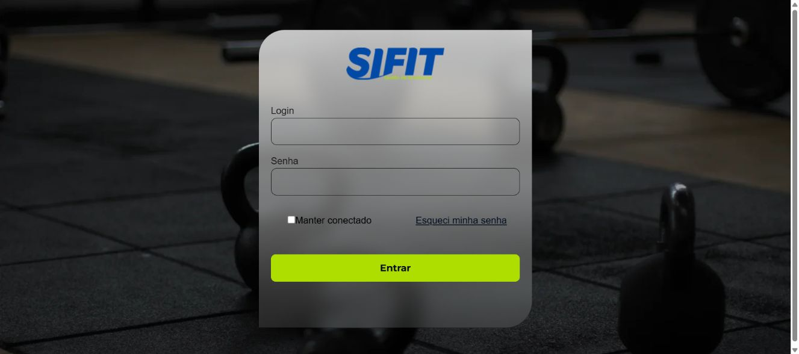
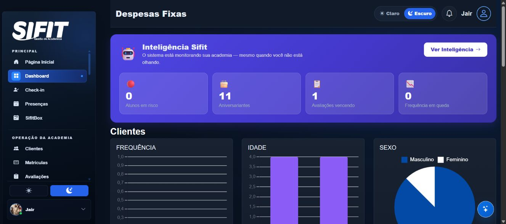
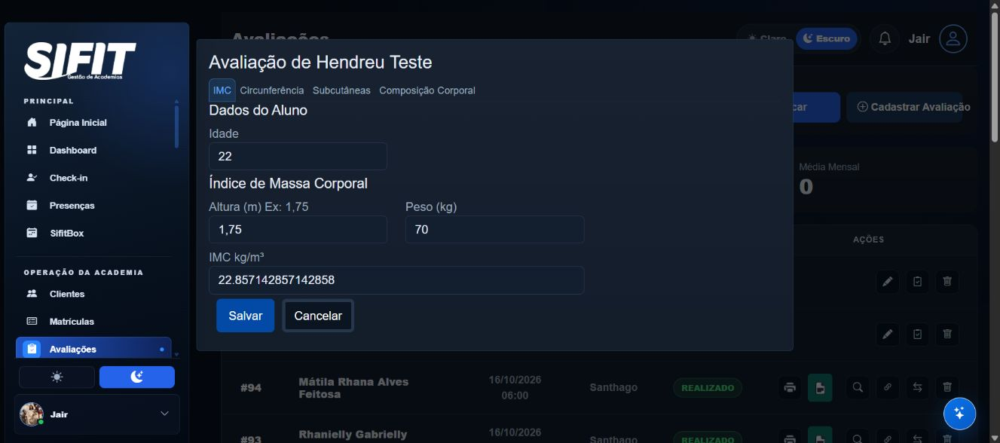
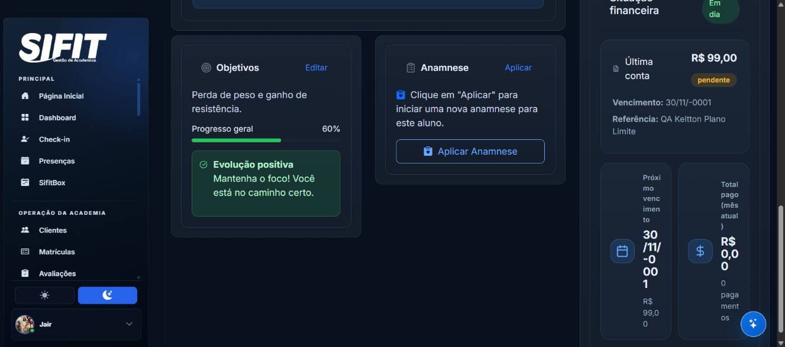

# Relatório de bugs · Sifit

[← Índice](README.md) · [Execução](4-relatorio-de-execucao.md) · [Evidências](evidencias/README.md)

**Data:** 21/10/2026 · **Estado dos registros:** Aberto, sem correção/reteste disponível.

> Severidades e prioridades são propostas para revisão acadêmica. Os cinco registros abaixo descrevem defeitos observados. Suspeitas e funcionalidades declaradas em desenvolvimento estão separadas em [pendências](7-pendencias.md).

| ID | Título | Severidade | Prioridade |
| --- | --- | --- | --- |
| BUG-001 | Recuperação de senha não apresenta fluxo ou orientação | Média | Alta |
| BUG-002 | Dashboard exibe título Despesas Fixas | Baixa | Média |
| BUG-003 | IMC exibe unidade kg/m³ | Baixa | Média |
| BUG-004 | Perfil apresenta vencimento com ano negativo | Média | Alta |
| BUG-005 | Meu perfil apresenta conteúdo de demonstração | Média | Média |

## BUG-001 · Recuperação de senha não apresenta fluxo ou orientação

| Atributo | Valor |
| --- | --- |
| Requisito / caso | RF01 / CT-RF01-04 |
| Severidade / prioridade | Média / Alta |
| Status | Aberto |
| Ambiente | Windows; navegador integrado do Codex; versão não coletada; Sifit web |
| Rota | /login |
| Banco | Não inspecionado |
| JAM | Pendente de gravação — nenhum link foi inventado |

**Passos para reproduzir:** Sem sessão; abrir login e clicar Esqueci minha senha.

**Esperado:** Abrir recuperação de acesso ou informar um procedimento de suporte.

**Obtido:** A tela permaneceu no login, sem formulário ou mensagem acionável. O link aponta para /login#.

**Limite da análise:** Repetido na sessão. O destino #, sozinho, não é a prova: o resultado do clique também foi observado. A captura estática mostra o estado final; o JAM deve provar a ausência de resposta.

**Evidência:**

**Reteste:** repetir o caso vinculado após correção; registrar data, versão, resultado e nova evidência, preservando esta execução.

---

## BUG-002 · Dashboard exibe título Despesas Fixas

| Atributo | Valor |
| --- | --- |
| Requisito / caso | RF03 / CT-RF03-01 |
| Severidade / prioridade | Baixa / Média |
| Status | Aberto |
| Ambiente | Windows; navegador integrado do Codex; versão não coletada; Sifit web |
| Rota | /dash |
| Banco | Não inspecionado |
| JAM | Pendente de gravação — nenhum link foi inventado |

**Passos para reproduzir:** Entrar e abrir o item Dashboard; aguardar gráficos e conferir o cabeçalho.

**Esperado:** Título compatível com Dashboard/painel analítico.

**Obtido:** Cabeçalho Despesas Fixas com Dashboard selecionado e gráficos de indicadores.

**Limite da análise:** Falha de identificação visual confirmada. Não implica que os dados dos gráficos estejam errados.

**Evidência:**

**Reteste:** repetir o caso vinculado após correção; registrar data, versão, resultado e nova evidência, preservando esta execução.

---

## BUG-003 · IMC exibe unidade kg/m³

| Atributo | Valor |
| --- | --- |
| Requisito / caso | RF09 / CT-RF09-09 |
| Severidade / prioridade | Baixa / Média |
| Status | Aberto |
| Ambiente | Windows; navegador integrado do Codex; versão não coletada; Sifit web |
| Rota | /avaliacoes |
| Banco | Não inspecionado |
| JAM | Pendente de gravação — nenhum link foi inventado |

**Passos para reproduzir:** Abrir Fazer Avaliação de registro de teste; selecionar IMC; conferir o rótulo. Para evidência do cálculo, informar 1,75 e 70 sem salvar.

**Esperado:** Unidade kg/m², compatível com peso dividido por altura ao quadrado.

**Obtido:** Rótulo IMC kg/m³. O cálculo visual retornou 22.857142857142858 para os valores fictícios.

**Limite da análise:** Defeito de unidade/rótulo. O cálculo visual deste exemplo foi coerente; não se concluiu que a fórmula esteja errada nem se homologaram interpretações de saúde.

**Evidência:**

**Reteste:** repetir o caso vinculado após correção; registrar data, versão, resultado e nova evidência, preservando esta execução.

---

## BUG-004 · Perfil apresenta vencimento com ano negativo

| Atributo | Valor |
| --- | --- |
| Requisito / caso | RF07 / CT-RF07-08 |
| Severidade / prioridade | Média / Alta |
| Status | Aberto |
| Ambiente | Windows; navegador integrado do Codex; versão não coletada; Sifit web |
| Rota | /visualizar-cliente/{id} |
| Banco | Não inspecionado |
| JAM | Pendente de gravação — nenhum link foi inventado |

**Passos para reproduzir:** Abrir o registro de teste inspecionado, ID 414, se ainda existir; aguardar situação financeira; ler vencimento e próximo vencimento.

**Esperado:** Data válida ou tratamento explícito de data ausente/inválida.

**Obtido:** Vencimento e próximo vencimento mostraram 30/11/-0001.

**Limite da análise:** Confirmado na apresentação. A origem pode envolver dado legado/inválido ou conversão; causa, data armazenada e relacionamento ainda não verificados. Se o registro mudar, preparar fixture equivalente após acesso ao banco.

**Evidência:**

**Reteste:** repetir o caso vinculado após correção; registrar data, versão, resultado e nova evidência, preservando esta execução.

---

## BUG-005 · Meu perfil apresenta conteúdo de demonstração

| Atributo | Valor |
| --- | --- |
| Requisito / caso | RF46 / CT-RF46-01 |
| Severidade / prioridade | Média / Média |
| Status | Aberto |
| Ambiente | Windows; navegador integrado do Codex; versão não coletada; Sifit web |
| Rota | /profile |
| Banco | Não inspecionado |
| JAM | Pendente de gravação — nenhum link foi inventado |

**Passos para reproduzir:** Entrar; abrir o menu da conta; clicar Meu perfil; aguardar a página.

**Esperado:** Perfil coerente com a conta ou estado vazio apropriado.

**Obtido:** Página mostrou Hello Jesse, Jessica Jones e conteúdo demonstrativo em inglês.

**Limite da análise:** Conteúdo demonstrativo e incoerência confirmados pela interface. Não é evidência de vazamento de dados de outra pessoa real.

**Evidência:**

**Reteste:** repetir o caso vinculado após correção; registrar data, versão, resultado e nova evidência, preservando esta execução.

---
