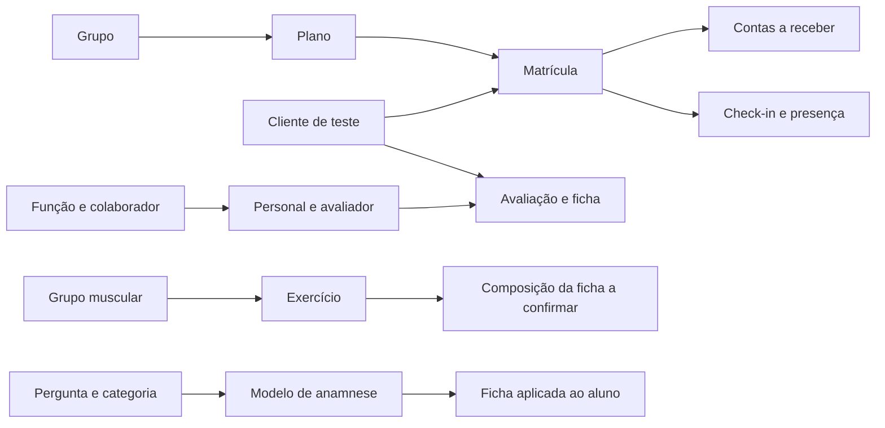

# Roteiro de validação · Banco e JAM

[← Índice](README.md) · [Cenários e matriz](5-matriz-de-rastreabilidade.md) · [Registro de evidências](evidencias/registro-de-evidencias.md)

## O que será confirmado ao receber o banco

Identificar SGBD, versão, ambiente, esquema, tabelas, chaves primárias/estrangeiras, escopo da academia/unidade, exclusão lógica, timestamps, campos calculados e rotinas automáticas. Relacionar cada formulário ao modelo real antes de escrever SQL definitivo. Não há nomes de tabelas, credenciais ou resultados de consultas presumidos nesta documentação.

Começar com leitura: listar metadados, localizar o registro de teste por ID e verificar referências. A conta do banco pode ser somente leitura para evidenciar as alterações produzidas pela interface. Não são necessárias alterações diretas para demonstrar CRUD no site.

## Dependências para organizar a massa



Este diagrama representa dependências funcionais sugeridas pelas telas, não um diagrama físico do banco. Cardinalidades, nomes de chaves e vínculos efetivos serão confirmados no esquema real.

## Ciclo de um teste de persistência

| Etapa | Ação no site | Confirmação no banco | Evidência |
| --- | --- | --- | --- |
| Preparar | Abrir formulário e identificar dependências | Consultar ausência da massa e estado dos pais | ID do caso, execução e horário |
| Criar | Cadastrar QA_SIFIT_<execução> com dados fictícios | Encontrar ID novo e valores; conferir referências | Formulário, sucesso, lista e linha no banco |
| Recarregar | Reabrir registro pelo ID | Reconsultar o mesmo ID | Persistência após nova consulta |
| Alterar | Modificar um campo identificável | Mesmo ID, novo valor, referências preservadas | Antes/depois e timestamp se existente |
| Excluir/cancelar | Acionar operação prevista somente na massa dedicada | Ausência ou flag/status conforme regra real | Diálogo, resultado e consulta por ID |
| Encerrar | Confirmar efeitos e preservar evidências | Conferir dependências e limpeza autorizada | Resultado, bug e link JAM |

Uma linha sumir da lista não prova exclusão física. Um toast de sucesso não prova commit. Uma mudança no contador não identifica qual registro foi salvo. É necessário correlacionar pelo ID e pela massa.

## Consultas: modelo conceitual, ainda não executável

```text
ANTES: consultar <tabela_real> pelo <identificador_da_massa>
APÓS CRIAR: consultar <tabela_real> pela <chave_primária_gerada>
APÓS ALTERAR: consultar a mesma chave e comparar os campos alterados
APÓS EXCLUIR: conferir ausência, flag de exclusão ou status documentado
VÍNCULOS: consultar referências pela chave real, respeitando academia/unidade
```

Substituir os marcadores apenas após ler o esquema. Evitar SELECT * em gravações: selecionar somente ID, campos necessários e referências, ocultando dados pessoais e segredos.

## Como gravar no JAM

1. Abrir o caso e explicar brevemente o resultado esperado. Mostrar ambiente e massa fictícia, sem revelar credenciais.
2. Iniciar a captura no JAM com a ferramenta disponível no navegador do aluno. Fazer um ensaio para verificar se a alternância para o cliente de banco entra na gravação; o escopo de captura depende da configuração disponível.
3. Mostrar a consulta anterior e a ausência/estado da massa, mantendo visível o identificador da execução.
4. Executar uma operação de cada vez no site. Aguardar o carregamento, mostrar a confirmação e recarregar o registro.
5. Atualizar a consulta do banco pelo ID e mostrar os valores correspondentes. Para editar, mostrar antes/depois; para excluir, demonstrar a regra física/lógica real.
6. Encerrar a gravação, revisar se segredos ficaram visíveis e copiar o link real para o registro de evidências.
7. Anotar caso, execução, ID da massa, horário, resultado e eventual BUG. Se falhar, manter o vídeo da falha e abrir um novo registro para reteste.

Se o JAM disponível capturar apenas o site e não o cliente de banco, gravar evidências complementares separadas e ligá-las pelo mesmo ID de execução, ou usar o escopo de captura adequado que o aluno tiver disponível. Não afirmar que o banco foi mostrado sem conferir o vídeo final.

## Ordem sugerida das gravações

1. Autenticação, recuperação, logout e rota protegida.
2. Cadastros auxiliares: grupo, plano, função, exercício, objetivo e tipos financeiros.
3. Cliente → matrícula → contas → check-in/presença.
4. Avaliação → medidas → resultado/PDF; ficha/modelo → exercícios.
5. Perguntas/categorias → modelo → aplicação de anamnese.
6. Fornecedor → conta a pagar → caixa de teste.
7. Prospecção, campanhas/produtos/enquetes e aplicativo em ambiente dedicado.
8. Automações/WhatsApp/Pagar.me somente com sandbox, destinatário e infraestrutura de teste definidos.

## Preparação da fase seguinte

- [ ] Informar SGBD e modo de acesso por canal privado.
- [ ] Confirmar se o site e banco são de homologação e se há outros usuários testando.
- [ ] Definir academia/unidade e massa que pode ser criada e removida.
- [ ] Confirmar recuperação e efeitos de exclusão/cancelamento.
- [ ] Mapear entidades e substituir consultas conceituais por consultas reais.
- [ ] Confirmar nomes do aluno, curso, instituição, professor e prazos para a capa acadêmica.
- [ ] Preparar JAM e verificar captura da tela do banco.

Nenhuma senha de acesso deve ser incluída nos arquivos Markdown ou vídeos. Os links JAM permanecem pendentes até as gravações existirem.
